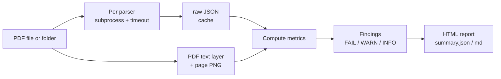

# parseoff

**English** | [한국어](README.ko.md)

parseoff runs several PDF parsers (pypdf, pdfplumber, pdfminer, and markitdown / pymupdf4llm / docling when installed) on *your own* PDFs and shows their output next to the original page image, with metrics that need no ground truth, plus licence and install-size warnings. One command (`parseoff run ./내폴더`, where `내폴더` means "my folder") replaces writing a script per parser and comparing output files by eye, and everything is processed on your own computer. Use it when you pick a parser for a RAG ingestion step, or before upgrading one. Not on PyPI yet (planned): `git clone` the repo, then `uv run parseoff demo`.


*One page of the report made by `parseoff demo`. The original is on the left and the per-parser results are on the right. It is the same page, but each parser reads it in a different order.*

## Who it is for
- People choosing, for the first time, a parser to turn PDFs into text for RAG or document search
- People who want to see how results change on their own documents before upgrading a parser version
- People who cannot upload documents to an external service and need to compare only parsers that run offline

## Installation

Prerequisites: Python 3.11-3.13 (the repo's `.python-version` is 3.12, so uv picks that version; 3.14 and later are not supported because the optional parsers' dependency packages have no wheels for it), [uv](https://docs.astral.sh/uv/).

```bash
curl -LsSf https://astral.sh/uv/install.sh | sh   # if you do not have uv
git clone https://github.com/LeeGyeongPil/parseoff
cd parseoff
uv run parseoff --version
```
```text
parseoff 0.1.1
```

- The method above (clone, then `uv run`) is the confirmed way to install. The first `uv run` downloads the dependency packages.
- Publishing to PyPI is planned (not yet). Once published, you will run it directly with `uvx parseoff demo`. After the public release, `uv tool install git+https://github.com/LeeGyeongPil/parseoff` will also work.
- On a minimal Linux environment, you need `git`, `curl` and Python. No other system packages are needed (PDF rendering is included in the `pypdfium2` wheel).
- Optional parser (not in the default install): `uv sync --extra markitdown` (MIT, about 147 MB installed). See "Adding parsers and licences" below.

## Quick start

First run `demo`, the **practice (mock) mode**. The code makes 3 synthetic PDFs (so you do not need documents of your own), and the parsers really run. The only difference from the real mode (`run`) is the input documents. The synthetic documents are very simple, so the differences look clearer than on real documents.

```bash
uv run parseoff demo --out demo-out
```
```text
parseoff demo - practice mode: 3 synthetic PDFs, real parsers
  report-table.pdf: pypdf ok 0.09s
  report-table.pdf: pdfplumber ok 0.07s
  ...
  two-column.pdf: pdfminer ok 0.10s

3 documents, parsers: pypdf, pdfplumber, pdfminer
skipped markitdown: not installed (uv sync --extra markitdown)
skipped pymupdf4llm: not installed (uv pip install pymupdf4llm; AGPL-3.0, check its terms)
skipped docling: opt-in only: add docling to --parsers (model download on first run)
FAIL 1, WARN 2, INFO 5 - exit 0 (use --strict to fail)
report: demo-out/report/index.html
```


*The run screen. The times (seconds) differ from computer to computer.*

- `FAIL 1, WARN 2, INFO 5` are the counts of **findings**. FAIL means "a problem if used as is", WARN means "check by eye", and INFO is for reference.
- The exit code is 0 even when there are findings (1 only with `--strict`).
- Open `demo-out/report/index.html` in a browser. It is a static file that needs no server or internet. Directly under the output folder (`demo-out/`), `summary.json` (for machines) and `summary.md` (for people) are also created.

To run it on your own documents, just pass a folder (or a single PDF file).

```bash
uv run parseoff run ./내-pdf-폴더 --out my-out --max-pages 20
```
(`./내-pdf-폴더` means "my PDF folder".)

## Usage

| Command / option | What it does | Example |
|---|---|---|
| `doctor` | Shows, as a table, whether each of the 6 known parsers is installed, its actual version, licence, install size and warnings | `parseoff doctor` |
| `demo` | Makes 3 synthetic PDFs and compares them with the default parsers (practice) | `parseoff demo --out demo-out` |
| `run INPUT` | Compares a PDF file or folder (including subfolders) with all installed parsers | `parseoff run ./docs` |
| `--out DIR` | Output folder (`run` default `parseoff-out`, `demo` default `demo-out`) | `--out my-out` |
| `--parsers a,b` | Choose the parsers to run yourself (`docling` runs only if listed here) | `--parsers pypdf,pdfplumber` |
| `--max-pages N` | Analyze only the first N pages of each document | `--max-pages 20` |
| `--timeout SEC` | Time limit per (document, parser), default 120 seconds | `--timeout 60` |
| `--custom NAME=module:function` | Add your own parser to the same report (repeatable) | See below |
| `--min-coverage X` / `--min-agreement X` | Thresholds for LOW_COVERAGE (default 0.8) / LOW_AGREEMENT (default 0.6) | `--min-agreement 0.7` |
| `--strict` | Exit code 1 if there are FAIL findings (for CI) | `--strict` |
| `--fresh` | Ignore cached parser results and run again | `--fresh` |
| `--no-render` | Do not make page images | `--no-render` |

Exit codes: 0 (normal, even with findings), 1 (`--strict` and there are FAIL findings), 2 (usage error, e.g. a folder that does not exist).

### 1. Check install status and licences

```bash
uv run parseoff doctor
```
```text
parser       installed  version   license                 install size*                on disk  notes
pypdf        yes        7.0.0     BSD-3-Clause            1.8 MB                       1.8 MB   pure Python; text in content-stream order, no structure
pdfplumber   yes        0.11.10   MIT                     41 MB                        0.2 MB   text by position + tables as GFM (includes pypdfium2, pdfminer.six)
pdfminer     yes        20260107  MIT                     part of pdfplumber           8.6 MB   layout-box text; markitdown's PDF path is pdfminer text extraction
markitdown   no         -         MIT                     147 MB                       -        most of the size is onnxruntime; page-split (one conversion per page); ...
pymupdf4llm  no         -         AGPL-3.0 or commercial  214 MB                       -        detected only if you installed it; not an extra of parseoff; WARNING copyleft licence; ...
docling      no         -         MIT                     not measured (large, torch)  -        experimental; WARNING model download on first run (local models: not found); ...
```

(The `notes` column is long, so it is shortened with `...`.) `install size` is a researched value measured by installing into an isolated environment on 2026-11-10, while `version` and `on disk` are values read from your own environment. Licences and sizes are for reference and are not legal advice.


*The `doctor` screen. Before installing, you can check "is it AGPL? why 200 MB?"*

### 2. Reading the report

`index.html` has three things: a document x parser table (status, time, coverage, table and heading counts), a pairwise agreement matrix between parsers, and a list of findings. Click a document name and, page by page, the **original image + each parser's result** appear side by side.


*The overview screen. Look at the findings' badges to decide which page of which document to open.*

All metrics are computed **without ground truth**. That is why they have limits.

| Metric | Meaning | Limit |
|---|---|---|
| Coverage | The share of the words in the PDF's own text layer that the parser captured | Can be 100% even when structure (tables, order) is lost |
| Agreement | How similar the word order of two parsers' outputs is (0-1) | A low value does not mean "someone is wrong". It means **a page to look at by eye** |
| Table and heading counts | Counts of GFM tables and Markdown headings (`#`) | Not an error if a parser fails to find tables |
| Repeated-line ratio | The share taken by lines that repeat across pages (headers, footers, page numbers) | Deliberately repeated phrases are counted too |
| Estimated tokens | Number of characters / 4 (an estimate) | Differs from a real tokenizer |

### 3. Three lessons the demo shows

The 3 synthetic PDFs of `demo` show one lesson each. The figures below are values obtained by actually running this demo. (They are synthetic documents, so simpler than real ones.)

**① Table structure (`report-table.pdf` page 1)** — the table count is 1 for pdfplumber, 0 for pypdf, 0 for pdfminer. Yet coverage is 100% for all three parsers. That means they all took all the characters, but only pdfplumber kept the table shape. It is a real example of the limit that metrics without ground truth cannot show structural loss. The header "ACME Handbook - draft" and the page number repeat, giving a repeated-line ratio of 23% and a BOILERPLATE warning (the header gets mixed into RAG chunks).


*The table page. The same cell values come out as a table or as a list of lines depending on the parser.*

**② Two-column reading order (`two-column.pdf` page 1)** — the pairwise agreement between parsers is 0.50-0.54. pypdf reads the right column first, pdfminer reads the left column first, and pdfplumber mixes the two columns line by line (the top image). Coverage is 100% because the words are the same, but reading order matters for RAG. Since page 1 is below the threshold (0.6), a LOW_AGREEMENT warning appears. Page 2, which has one column, has an agreement of 1.00.

**③ A page with no text layer (`scanned-like.pdf` page 2)** — a page that is only an image. All three parsers have status `ok` and 0 characters. In that case coverage is recorded as not computable (`null`) rather than 0, and an `EMPTY_TEXT_LAYER` FAIL finding ("OCR needed") is raised. It is not an error but means "a document the parser cannot handle".


*The scanned page. The parser results are empty and a FAIL badge is attached.*

### 4. Using it in CI

```bash
uv run parseoff run demo-out/samples --out strict-out --strict; echo "exit code: $?"
```
```text
...
FAIL 1, WARN 2, INFO 5 - exit 1
report: strict-out/report/index.html
exit code: 1
```


*`--strict` returns exit code 1 only when there are FAIL findings.*

### 5. Adding your own parser

One function is enough. The arguments are `(pdf_path, page_numbers)` (page numbers start at 1), and it returns a list with one string per requested page. The repository's [`examples/upper_parser.py`](examples/upper_parser.py):

```python
from pypdf import PdfReader


def to_pages(pdf_path: str, page_numbers: list[int]) -> list[str]:
    reader = PdfReader(pdf_path)
    return [(reader.pages[n - 1].extract_text() or "").upper() for n in page_numbers]
```

```bash
uv run parseoff run demo-out/samples --out custom-out --parsers pypdf --custom mine=examples.upper_parser:to_pages
```
```text
  report-table.pdf: pypdf ok 0.09s
  report-table.pdf: mine ok 0.13s
  ...
3 documents, parsers: pypdf, mine
FAIL 1, WARN 1, INFO 0 - exit 0 (use --strict to fail)
report: custom-out/report/index.html
```

The module is looked up in the current folder (or the environment variable `PARSEOFF_PATH`). **The code of the module you specify is run as is, so use only code you trust.** A custom parser's version does not change when its code changes, so its results are not cached.

## Configuration

There are no configuration files or environment variables (no API key is needed either). All settings are command arguments. Two exceptions:

- `PARSEOFF_PATH` — folders where `--custom` modules are looked up (several, separated by the OS path separator).
- `DOCLING_ARTIFACTS_PATH` — the folder where docling models already exist. `doctor` checks whether the models are present.

**Result folder**: `report/` (HTML, page images `img/*.png`), `raw/<document>/<parser>.json` (the parser's raw result, which doubles as the cache), `summary.json`, `summary.md`, `samples/` (demo only). The cache key is the file sha256 + parser name + installed parser version + page list, and only `status ok` is reused. `summary.json` has no timestamps or absolute paths. With the cache, the same input gives the same result files, and when re-running with `--fresh`, only the parser run time (`seconds`) can differ.

**Privacy**: all processing happens on your own computer and uses no network (the optional parser docling downloads models on its first run). However, the output folders (`raw/`, `report/`) **contain the document contents and page images as they are.** Do not share reports of sensitive documents.

### Adding parsers and licences

| Parser | Licence | Install size (researched, 2026-11-10) | Notes | Install |
|---|---|---|---|---|
| pypdf | BSD-3-Clause | 1.8 MB | Included by default | Not needed |
| pdfplumber | MIT | 41 MB | Included by default, tables as GFM | Not needed |
| pdfminer.six | MIT | Included in pdfplumber | Included by default | Not needed |
| markitdown | MIT | 147 MB (mostly onnxruntime) | Converts page by page | `uv sync --extra markitdown` |
| pymupdf4llm | AGPL-3.0 or commercial | 214 MB | Auto-detected if installed. **Not in extras** | `uv pip install pymupdf4llm` (you may need to install it again after `uv sync`) |
| docling | MIT | Not measured (torch, large) | Experimental. Runs only if listed in `--parsers`, model download on first run | `uv sync --extra docling` |

If you run `uv sync --extra …` for one extra at a time, the extras you added earlier are removed. When you use more than one, specify them in a single call, as in `uv sync --extra markitdown --extra docling`.

pymupdf4llm is AGPL, so it was not put in parseoff's extras. If you install it yourself, parseoff only calls it, with a badge and a warning (LICENSE_COPYLEFT) attached. Checking the licence is your responsibility. marker is not supported yet because of its model-weight terms.

## How it works



1. **PDF input** — takes a single file or a folder (including subfolders).
2. **Subprocess + timeout** — runs each (document, parser) in a separate process (`python -m parseoff.worker`). Even if a parser crashes or hangs, the other parsers' results remain intact, and when time runs out only that process is terminated.
3. **raw JSON and cache** — results are stored in `raw/` right away, and the same file, parser and version are not run again (ignore with `--fresh`).
4. **Text layer and page PNG** — pypdfium2 produces the text the PDF holds and the page images. This becomes the baseline for coverage and the report's original image.
5. **Compute metrics** — coverage, pairwise agreement between parsers (standard library `difflib`), table and heading counts, repeated lines, estimated tokens.
6. **Findings** — FAIL / WARN / INFO are attached by rules and thresholds.
7. **Report** — static HTML with no external resources or scripts (all text produced by parsers is HTML-escaped), plus `summary.json` and `summary.md`.

## When to use it
- Use it when: choosing a parser for the first time on your own PDFs, upgrading a parser version, or when you cannot upload documents externally (everything runs locally). Even without ground-truth data, it narrows down "which spots to look at by eye".
- Use another tool when: if you need a public benchmark that ranks parsers by score against ground-truth Markdown, use a benchmark such as [opendataloader-bench](https://github.com/opendataloader-project/opendataloader-bench); for scanned documents that need OCR, use a parser with OCR (for example [docling](https://github.com/docling-project/docling)) directly. This tool does not do OCR.
- Not there yet: ground-truth scoring, comparison with a previous run (`diff`) and marker support are planned next. Formats other than PDF, such as HWP and DOCX, are not handled either.

## Troubleshooting

| Symptom | Cause | Fix |
|---|---|---|
| `error: ...: no such file or folder` (exit code 2) | The input path does not exist or the folder has no PDFs | Pass a PDF file or a folder containing PDFs |
| Coverage is `null` / `EMPTY_TEXT_LAYER` | A scanned or image-only page (no text layer) | OCR is needed. Comparing text parsers will not solve it |
| Coverage is 100% but the result looks wrong | Coverage counts only characters and cannot see tables or order | Look at agreement and table counts together, and check that page by eye in the report |
| `skipped markitdown: not installed` | The optional parser is not installed | Run the install command shown in the message. If you cloned the repo, it is `uv sync --extra markitdown` |
| `skipped pymupdf4llm: not installed` | AGPL, so it is not in extras | `uv pip install pymupdf4llm` (install again after `uv sync`). Check the licence yourself |
| `skipped docling: opt-in only` | docling is not run automatically | List it explicitly, as in `--parsers pypdf,pdfplumber,docling` (model download on first run) |
| The same result keeps coming out | Cache (same file, parser and version) | Add `--fresh` |
| `cannot import module ... for custom parser` | The `--custom` module is not in the current folder | Run from the folder containing the module or set `PARSEOFF_PATH`. In the terminal the cause appears on the line below `mine error`, and the full wording is in the `PARSER_ERROR` finding of `summary.md` |
| `uv run` prints a hardlink warning | The cache and the project are on different filesystems | Harmless. To hide it, use `UV_LINK_MODE=copy` |

## Development and contributing

```bash
uv run pytest -q
```
```text
..............................                                           [100%]
```

The 30 tests pass without network or model downloads, with no optional parsers installed (they take about 10-20 seconds because of the timeout test). Please leave bugs and suggestions as issues. Change history is in [CHANGELOG.md](CHANGELOG.md).

## Learn more
- [pypdf](https://pypdf.readthedocs.io/) · [pdfplumber](https://github.com/jsvine/pdfplumber) · [pdfminer.six](https://github.com/pdfminer/pdfminer.six) · [markitdown](https://github.com/microsoft/markitdown) · [PyMuPDF4LLM](https://pymupdf.readthedocs.io/en/latest/pymupdf4llm/) · [docling](https://github.com/docling-project/docling) (all official repositories and documentation checked on 2026-11-10)
- Versions checked: Python 3.12 / pypdf 7.0.0 / pdfplumber 0.11.10 / pdfminer.six 20260107 / reportlab 5.1.0 (macOS arm64, 2026-11-10)

## License
MIT. For the licences of dependent parsers, see the table above (the synthetic PDFs of `demo` are generated directly by code and use no external data).
