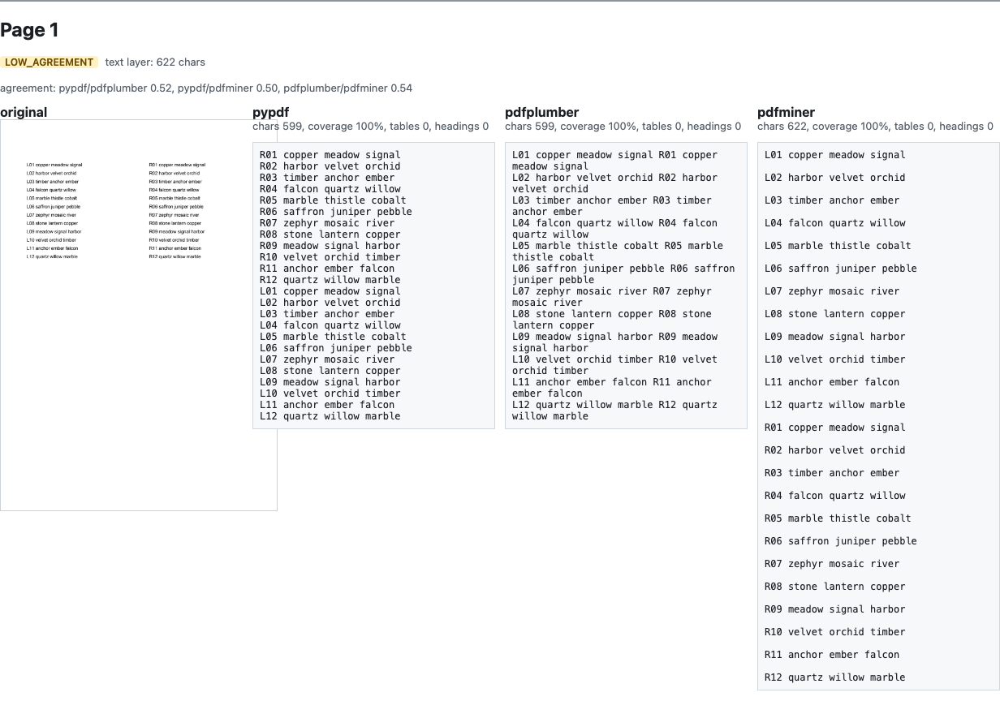
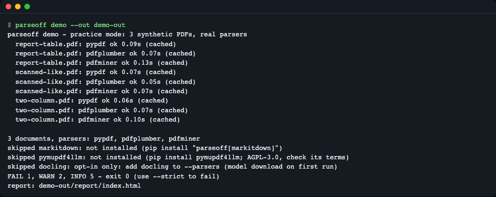
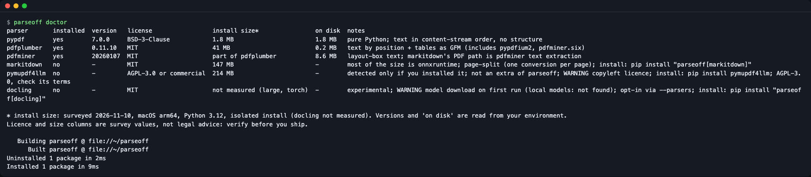
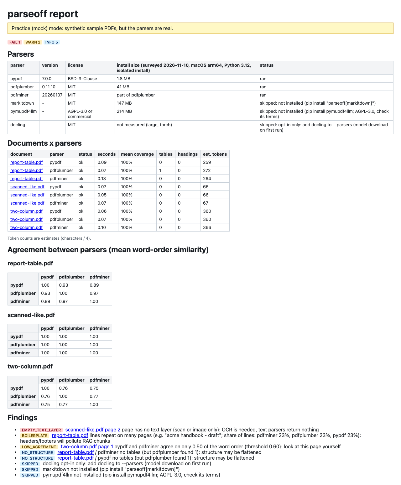
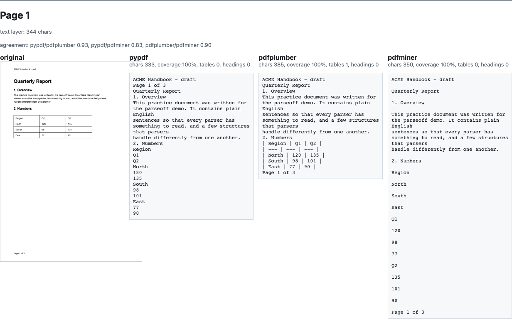
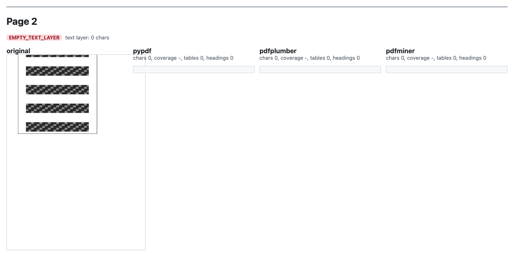
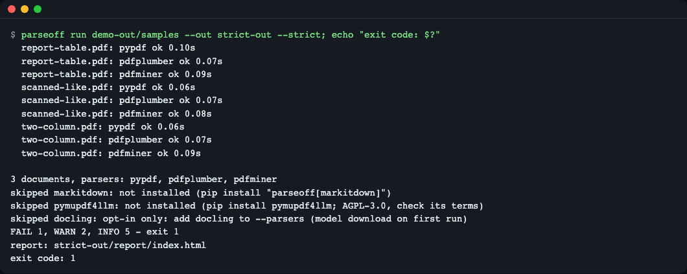
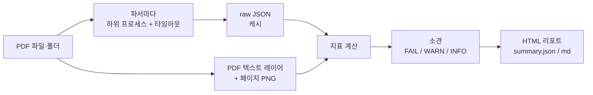

# parseoff

> **English summary** — parseoff runs several PDF parsers (pypdf, pdfplumber, pdfminer, and markitdown / pymupdf4llm / docling when installed) on *your own* PDFs and shows their output next to the original page image, with metrics that need no ground truth, plus licence and install-size warnings. Use it when you pick a parser for a RAG ingestion step, or before upgrading one. Not on PyPI yet (planned): `git clone` the repo, then `uv run parseoff demo`.

PDF 파서를 고를 때 파서마다 스크립트를 따로 짜서 출력 파일을 눈으로 비교하던 일을, 명령 하나(`parseoff run ./내폴더`)로 대신해 주는 CLI 입니다. 모든 처리는 내 컴퓨터에서만 일어납니다.


*`parseoff demo` 가 만든 리포트의 한 페이지. 왼쪽이 원본, 오른쪽이 파서별 결과. 같은 페이지인데 파서마다 읽는 순서가 다릅니다.*

## 이런 분께
- RAG·문서 검색용으로 PDF 를 텍스트로 바꿀 파서를 처음 고르는 분
- 파서 버전을 올리기 전에, 내 문서에서 결과가 어떻게 달라지는지 보고 싶은 분
- 문서를 외부 서비스에 올릴 수 없어서, 오프라인으로 돌아가는 파서만 비교해야 하는 분

## 설치

전제: Python 3.11~3.13(레포의 `.python-version` 은 3.12 라 uv 가 그 버전을 고릅니다. 3.14 이상은 선택 파서의 의존 패키지 휠이 없어 지원하지 않습니다), [uv](https://docs.astral.sh/uv/).

```bash
curl -LsSf https://astral.sh/uv/install.sh | sh   # uv 가 없다면
git clone https://github.com/LeeGyeongPil/parseoff
cd parseoff
uv run parseoff --version
```
```text
parseoff 0.1.0
```

- 위 방법(clone 후 `uv run`)이 확인된 설치 방법입니다. 처음 `uv run` 을 하면 의존 패키지를 내려받습니다.
- PyPI 게시는 예정입니다(아직 아님). 게시되면 `uvx parseoff demo` 로 바로 실행하게 됩니다. 공개 후에는 `uv tool install git+https://github.com/LeeGyeongPil/parseoff` 도 쓸 수 있습니다.
- 최소 리눅스 환경에서는 `git`, `curl`, 그리고 Python 이 필요합니다. 그 밖의 시스템 패키지는 필요 없습니다(PDF 렌더링은 `pypdfium2` 휠에 들어 있습니다).
- 선택 파서(기본에는 없음): `uv sync --extra markitdown` (MIT, 설치 약 147 MB). 아래 "파서 추가와 라이선스" 참고.

## 빠르게 시작하기

먼저 **연습용(mock) 모드**인 `demo` 를 돌려 봅니다. 합성 PDF 3개를 코드가 만들어 주고(그래서 내 문서가 없어도 됩니다), 파서는 진짜로 돌립니다. 실제 모드(`run`)와 다른 점은 입력 문서뿐입니다. 합성 문서는 아주 단순해서 실제 문서보다 차이가 뚜렷하게 보입니다.

```bash
uv run parseoff demo --out demo-out
```
```text
parseoff demo - practice mode: 3 synthetic PDFs, real parsers
  report-table.pdf: pypdf ok 0.09s
  report-table.pdf: pdfplumber ok 0.07s
  ...
  two-column.pdf: pdfminer ok 0.10s

3 documents, parsers: pypdf, pdfplumber, pdfminer
skipped markitdown: not installed (uv sync --extra markitdown (or pip install "parseoff[markitdown]"))
skipped pymupdf4llm: not installed (pip install pymupdf4llm; AGPL-3.0, check its terms)
skipped docling: opt-in only: add docling to --parsers (model download on first run)
FAIL 1, WARN 2, INFO 5 - exit 0 (use --strict to fail)
report: demo-out/report/index.html
```


*실행 화면. 시간(초)은 컴퓨터마다 다릅니다.*

- `FAIL 1, WARN 2, INFO 5` 는 **소견(finding)** 개수입니다. FAIL 은 "이대로 쓰면 문제", WARN 은 "눈으로 확인할 것", INFO 는 참고입니다.
- 소견이 있어도 종료코드는 0 입니다(`--strict` 를 줄 때만 1).
- `demo-out/report/index.html` 을 브라우저로 여세요. 서버도 인터넷도 필요 없는 정적 파일입니다. 출력 폴더(`demo-out/`) 바로 아래에 `summary.json`(기계용)과 `summary.md`(사람용)도 생깁니다.

내 문서로 돌릴 때는 폴더(또는 PDF 파일 하나)만 넘기면 됩니다.

```bash
uv run parseoff run ./내-pdf-폴더 --out my-out --max-pages 20
```

## 사용법

| 명령·옵션 | 하는 일 | 예 |
|---|---|---|
| `doctor` | 알려진 파서 6종의 설치 여부·실제 버전·라이선스·설치 크기·경고를 표로 보여 줌 | `parseoff doctor` |
| `demo` | 합성 PDF 3개를 만들어 기본 파서로 비교(연습용) | `parseoff demo --out demo-out` |
| `run INPUT` | PDF 파일 또는 폴더(하위 폴더 포함)를 모든 설치된 파서로 비교 | `parseoff run ./docs` |
| `--out DIR` | 출력 폴더(`run` 기본 `parseoff-out`, `demo` 기본 `demo-out`) | `--out my-out` |
| `--parsers a,b` | 실행할 파서를 직접 지정(`docling` 은 여기에 적어야만 실행) | `--parsers pypdf,pdfplumber` |
| `--max-pages N` | 문서마다 앞 N 쪽만 분석 | `--max-pages 20` |
| `--timeout SEC` | (문서, 파서)마다 제한 시간, 기본 120 초 | `--timeout 60` |
| `--custom NAME=module:function` | 내 파서를 같은 리포트에 추가(여러 번 가능) | 아래 참고 |
| `--min-coverage X` / `--min-agreement X` | LOW_COVERAGE(기본 0.8) / LOW_AGREEMENT(기본 0.6) 기준 | `--min-agreement 0.7` |
| `--strict` | FAIL 소견이 있으면 종료코드 1(CI 용) | `--strict` |
| `--fresh` | 캐시된 파서 결과를 무시하고 다시 실행 | `--fresh` |
| `--no-render` | 페이지 이미지를 만들지 않음 | `--no-render` |

종료코드: 0(정상, 소견이 있어도), 1(`--strict` 이고 FAIL 소견 있음), 2(사용 오류, 예: 없는 폴더).

### 1. 설치 상태와 라이선스 확인

```bash
uv run parseoff doctor
```
```text
parser       installed  version   license                 install size*                on disk  notes
pypdf        yes        7.0.0     BSD-3-Clause            1.8 MB                       1.8 MB   pure Python; text in content-stream order, no structure
pdfplumber   yes        0.11.10   MIT                     41 MB                        0.2 MB   text by position + tables as GFM (includes pypdfium2, pdfminer.six)
pdfminer     yes        20260107  MIT                     part of pdfplumber           8.6 MB   layout-box text; markitdown's PDF path is pdfminer text extraction
markitdown   no         -         MIT                     147 MB                       -        most of the size is onnxruntime; page-split (one conversion per page); ...
pymupdf4llm  no         -         AGPL-3.0 or commercial  214 MB                       -        detected only if you installed it; not an extra of parseoff; WARNING copyleft licence; ...
docling      no         -         MIT                     not measured (large, torch)  -        experimental; WARNING model download on first run (local models: not found); ...
```

(`notes` 열은 길어서 `...` 로 줄였습니다.) `install size` 는 2026-11-10 에 격리 환경에 설치해 잰 조사값이고, `version`·`on disk` 는 내 환경에서 읽은 값입니다. 라이선스·크기는 참고용이며 법률 자문이 아닙니다.


*`doctor` 화면. 설치하기 전에 "AGPL 인가? 왜 200 MB 인가?" 를 확인할 수 있습니다.*

### 2. 리포트 읽기

`index.html` 에는 세 가지가 있습니다. 문서 × 파서 표(상태·시간·커버리지·표·제목 수), 파서 쌍별 일치도 행렬, 소견 목록입니다. 문서 이름을 누르면 쪽마다 **원본 이미지 + 파서별 결과**가 나란히 나옵니다.


*개요 화면. 소견의 배지를 보고 어느 문서의 어느 쪽을 열어 볼지 정합니다.*

지표는 모두 **정답 없이** 계산됩니다. 그래서 한계가 있습니다.

| 지표 | 뜻 | 한계 |
|---|---|---|
| 커버리지 | PDF 자체의 텍스트 레이어에 있는 단어 중 파서가 가져온 비율 | 구조(표·순서)를 잃어도 100% 일 수 있음 |
| 일치도 | 두 파서가 낸 단어 순서가 얼마나 같은지(0~1) | 낮다고 "누가 틀렸다"는 뜻이 아님. **눈으로 볼 페이지**라는 뜻 |
| 표·제목 수 | GFM 표와 Markdown 제목(`#`)을 센 값 | 파서가 표를 못 찾아도 오류가 아님 |
| 반복 줄 비율 | 여러 쪽에 되풀이되는 줄(머리말·꼬리말·쪽 번호)이 차지하는 비율 | 일부러 반복되는 문구도 센다 |
| 추정 토큰 | 글자 수 / 4 (추정치) | 실제 토크나이저와 다름 |

### 3. 데모가 보여 주는 세 가지 교훈

`demo` 의 합성 PDF 3개는 각각 하나씩을 보여 줍니다. 아래 수치는 이 데모를 실제로 돌려 얻은 값입니다. (합성 문서라 실제 문서보다 단순합니다.)

**① 표 구조 (`report-table.pdf` 1쪽)** — 표 개수는 pdfplumber 1, pypdf 0, pdfminer 0. 그런데 세 파서 모두 커버리지는 100% 입니다. 글자는 다 가져왔지만 표 모양은 pdfplumber 만 살렸다는 뜻입니다. 정답 없는 지표만으로는 구조 손실이 안 보인다는 한계의 실제 예입니다. 머리말 "ACME Handbook - draft" 와 쪽 번호가 반복되어 반복 줄 비율 23% 로 BOILERPLATE 경고도 뜹니다(RAG 청크에 머리말이 섞입니다).


*표 쪽. 같은 셀 값이 파서마다 표 또는 줄 나열로 나옵니다.*

**② 2단 읽기 순서 (`two-column.pdf` 1쪽)** — 파서 쌍별 일치도가 0.50~0.54 입니다. pypdf 는 오른쪽 단을 먼저, pdfminer 는 왼쪽 단을 먼저 읽고, pdfplumber 는 줄 단위로 두 단을 섞습니다(맨 위 그림). 같은 단어들이라 커버리지는 100% 지만 RAG 에는 읽는 순서가 중요합니다. 1단인 2쪽은 일치도 1.00 입니다. 임계값(0.6) 아래이므로 LOW_AGREEMENT 경고가 뜹니다.

**③ 텍스트 레이어 없는 페이지 (`scanned-like.pdf` 2쪽)** — 이미지뿐인 쪽입니다. 세 파서 모두 상태는 `ok`, 글자는 0 자입니다. 이때 커버리지는 0 이 아니라 계산 불가(`null`)로 기록하고, `EMPTY_TEXT_LAYER` FAIL 소견("OCR 이 필요")을 냅니다. 오류가 아니라 "파서가 할 수 없는 문서"라는 뜻입니다.


*스캔 쪽. 파서 결과가 비어 있고 FAIL 배지가 붙습니다.*

### 4. CI 에서 쓰기

```bash
uv run parseoff run demo-out/samples --out strict-out --strict; echo "exit code: $?"
```
```text
...
FAIL 1, WARN 2, INFO 5 - exit 1
report: strict-out/report/index.html
exit code: 1
```


*`--strict` 는 FAIL 소견이 있을 때만 종료코드 1 을 돌려줍니다.*

### 5. 내 파서 넣기

함수 하나면 됩니다. 인자는 `(pdf_path, page_numbers)`(쪽 번호는 1부터), 반환은 요청한 쪽마다 문자열 하나인 목록입니다. 저장소의 [`examples/upper_parser.py`](examples/upper_parser.py):

```python
from pypdf import PdfReader


def to_pages(pdf_path: str, page_numbers: list[int]) -> list[str]:
    reader = PdfReader(pdf_path)
    return [(reader.pages[n - 1].extract_text() or "").upper() for n in page_numbers]
```

```bash
uv run parseoff run demo-out/samples --out custom-out --parsers pypdf --custom mine=examples.upper_parser:to_pages
```
```text
  report-table.pdf: pypdf ok 0.09s
  report-table.pdf: mine ok 0.13s
  ...
3 documents, parsers: pypdf, mine
FAIL 1, WARN 1, INFO 0 - exit 0 (use --strict to fail)
report: custom-out/report/index.html
```

모듈은 현재 폴더(또는 환경변수 `PARSEOFF_PATH`)에서 찾습니다. **지정한 모듈의 코드는 그대로 실행되므로 믿을 수 있는 것만 쓰세요.** 내 파서는 코드가 바뀌어도 버전이 바뀌지 않아서 결과를 캐시하지 않습니다.

## 설정

설정 파일과 환경변수는 없습니다(API 키도 필요 없습니다). 모든 설정은 명령 인자입니다. 예외 두 가지:

- `PARSEOFF_PATH` — `--custom` 모듈을 찾을 폴더(OS 경로 구분자로 여러 개).
- `DOCLING_ARTIFACTS_PATH` — docling 모델이 이미 있는 폴더. `doctor` 가 모델 존재 여부를 점검합니다.

**결과 폴더**: `report/`(HTML, 페이지 이미지 `img/*.png`), `raw/<문서>/<파서>.json`(파서 원본 결과, 캐시 겸용), `summary.json`, `summary.md`, `samples/`(demo 만). 캐시 키는 파일 sha256 + 파서 이름 + 설치된 파서 버전 + 쪽 목록이고 `status ok` 만 재사용합니다. `summary.json` 은 시각·절대경로가 없습니다. 캐시를 쓰면 같은 입력의 결과 파일이 같고, `--fresh` 로 다시 돌리면 파서 실행 시간(`seconds`)만 달라질 수 있습니다.

**개인정보**: 처리는 전부 내 컴퓨터에서 일어나고 네트워크를 쓰지 않습니다(선택 파서 docling 은 첫 실행에 모델을 내려받습니다). 단, 출력 폴더(`raw/`, `report/`)에는 **문서 내용과 페이지 이미지가 그대로 들어갑니다.** 민감한 문서의 리포트는 공유하지 마세요.

### 파서 추가와 라이선스

| 파서 | 라이선스 | 설치 크기(조사값, 2026-11-10) | 비고 | 설치 |
|---|---|---|---|---|
| pypdf | BSD-3-Clause | 1.8 MB | 기본 포함 | 필요 없음 |
| pdfplumber | MIT | 41 MB | 기본 포함, 표를 GFM 으로 | 필요 없음 |
| pdfminer.six | MIT | pdfplumber 에 포함 | 기본 포함 | 필요 없음 |
| markitdown | MIT | 147 MB (대부분 onnxruntime) | 쪽별로 나눠 변환 | `uv sync --extra markitdown` |
| pymupdf4llm | AGPL-3.0 또는 상업 | 214 MB | 설치돼 있으면 자동 감지. **extras 에 넣지 않음** | `pip install pymupdf4llm` |
| docling | MIT | 측정 안 함(torch, 큼) | 실험적. `--parsers` 에 적어야만 실행, 첫 실행에 모델 다운로드 | `uv sync --extra docling` |

pymupdf4llm 은 AGPL 이라서 parseoff 의 extras 에 넣지 않았습니다. 직접 설치하면 호출만 하며, 배지와 경고(LICENSE_COPYLEFT)가 붙습니다. 라이선스 확인은 본인 책임입니다. marker 는 모델 가중치 조건이 있어 아직 지원하지 않습니다.

## 동작 원리



1. **PDF 입력** — 파일 하나 또는 폴더(하위 폴더 포함)를 받습니다.
2. **하위 프로세스 + 타임아웃** — (문서, 파서)마다 별도 프로세스(`python -m parseoff.worker`)로 돌립니다. 파서가 죽거나 멈춰도 다른 파서 결과는 정상으로 남고, 시간이 넘으면 그 프로세스만 종료합니다.
3. **raw JSON·캐시** — 결과를 바로 `raw/` 에 쌓고, 같은 파일·파서·버전이면 다시 돌리지 않습니다(`--fresh` 로 무시).
4. **텍스트 레이어·페이지 PNG** — pypdfium2 로 PDF 가 가진 텍스트와 페이지 이미지를 만듭니다. 이것이 커버리지의 기준선이 되고, 리포트의 원본 이미지가 됩니다.
5. **지표 계산** — 커버리지, 파서 쌍별 일치도(표준 라이브러리 `difflib`), 표·제목 수, 반복 줄, 추정 토큰.
6. **소견** — 규칙과 임계값으로 FAIL / WARN / INFO 를 붙입니다.
7. **리포트** — 외부 리소스·스크립트가 없는 정적 HTML(파서가 낸 텍스트는 전부 HTML 이스케이프)과 `summary.json`·`summary.md`.

## 언제 쓰나
- 이럴 때: 내 PDF 로 파서를 처음 고를 때, 파서 버전을 올릴 때, 문서를 외부에 올릴 수 없을 때(전부 로컬 실행). 정답 데이터가 없어도 "어느 쪽을 눈으로 볼지"를 좁혀 줍니다.
- 이럴 땐 다른 도구: 정답 Markdown 과 점수로 파서를 겨루는 공개 벤치마크가 필요하면 [opendataloader-bench](https://github.com/opendataloader-project/opendataloader-bench) 같은 벤치마크, OCR 이 필요한 스캔 문서는 OCR 기능이 있는 파서(예: [docling](https://github.com/docling-project/docling)) 를 직접 사용하세요. 이 도구는 OCR 을 하지 않습니다.
- 아직 없는 것: 정답 기반 점수·이전 실행과의 비교(`diff`)·marker 지원은 다음 계획입니다. HWP·DOCX 등 PDF 외 형식도 다루지 않습니다.

## 자주 겪는 문제

| 증상 | 원인 | 해결 |
|---|---|---|
| `error: ...: no such file or folder` (종료코드 2) | 입력 경로가 없거나 PDF 가 없는 폴더 | PDF 파일 또는 PDF 가 든 폴더를 넘기세요 |
| 커버리지가 `null` / `EMPTY_TEXT_LAYER` | 스캔·이미지뿐인 쪽(텍스트 레이어 없음) | OCR 이 필요합니다. 텍스트 파서 비교로는 해결되지 않습니다 |
| 커버리지는 100% 인데 결과가 이상함 | 커버리지는 글자만 세고 표·순서를 못 봄 | 일치도·표 개수를 같이 보고, 리포트에서 해당 쪽을 눈으로 확인하세요 |
| `skipped markitdown: not installed` | 선택 파서가 설치되지 않음 | 메시지에 적힌 설치 명령을 실행하세요. clone 해서 쓰는 경우 `uv sync --extra markitdown` 입니다 |
| `skipped docling: opt-in only` | docling 은 자동 실행하지 않음 | `--parsers pypdf,pdfplumber,docling` 처럼 명시(첫 실행에 모델 다운로드) |
| 같은 결과가 계속 나옴 | 캐시(파일·파서·버전이 같음) | `--fresh` 를 붙이세요 |
| `cannot import module ... for custom parser` | `--custom` 모듈이 현재 폴더에 없음 | 모듈이 있는 폴더에서 실행하거나 `PARSEOFF_PATH` 를 지정하세요. 터미널에는 `mine error` 아래 줄에 원인이 나오고, 전체 문구는 `summary.md` 의 `PARSER_ERROR` 소견에 있습니다 |
| `uv run` 이 hardlink 경고를 냄 | 캐시와 프로젝트가 다른 파일시스템 | 무해합니다. 숨기려면 `UV_LINK_MODE=copy` |

## 개발·기여

```bash
uv run pytest -q
```
```text
..........................                                               [100%]
```

27개 테스트가 네트워크·모델 다운로드 없이, 선택 파서가 없는 상태에서 통과합니다(타임아웃 시험이 있어 10초쯤 걸립니다). 버그·제안은 이슈로 남겨 주세요. 변경 기록은 [CHANGELOG.md](CHANGELOG.md).

## 더 알아보기
- [pypdf](https://pypdf.readthedocs.io/) · [pdfplumber](https://github.com/jsvine/pdfplumber) · [pdfminer.six](https://github.com/pdfminer/pdfminer.six) · [markitdown](https://github.com/microsoft/markitdown) · [PyMuPDF4LLM](https://pymupdf.readthedocs.io/en/latest/pymupdf4llm/) · [docling](https://github.com/docling-project/docling) (모두 2026-11-10 확인한 공식 저장소·문서)
- 확인한 버전: Python 3.12 / pypdf 7.0.0 / pdfplumber 0.11.10 / pdfminer.six 20260107 / reportlab 5.1.0 (macOS arm64, 2026-11-10)

## 라이선스
MIT. 의존 파서의 라이선스는 위 표를 참고하세요(`demo` 의 합성 PDF 는 코드가 직접 생성하며 외부 데이터를 쓰지 않습니다).
